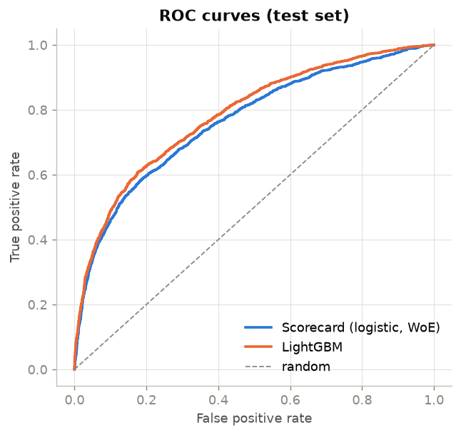
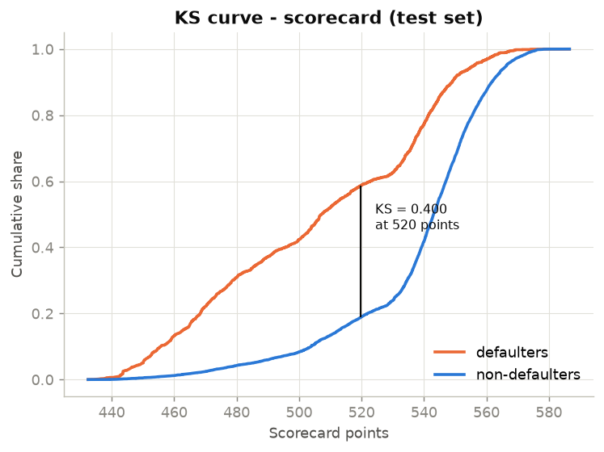
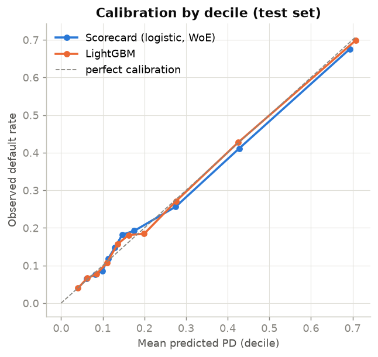
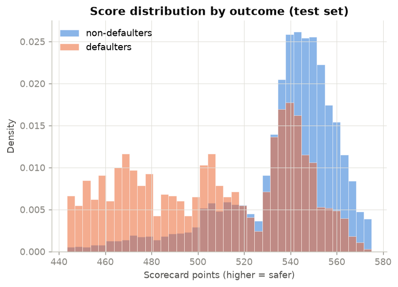
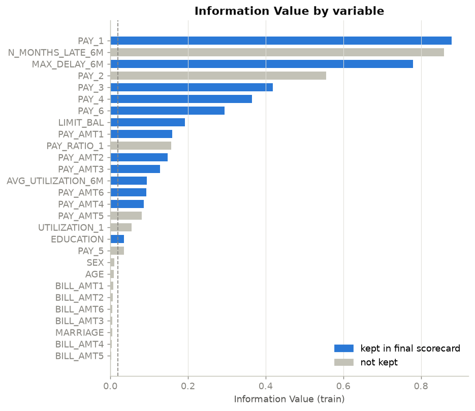
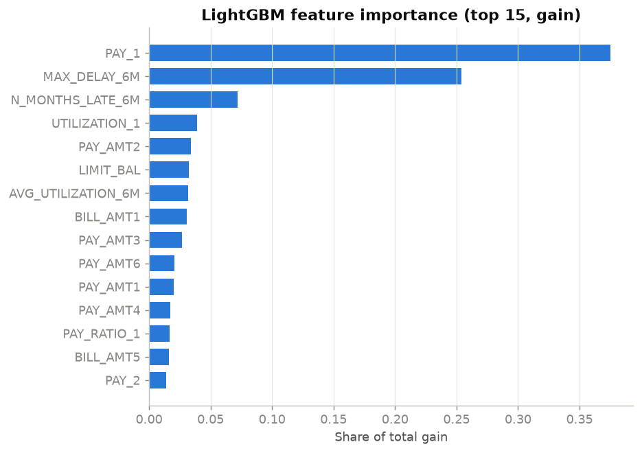

# 01 · Credit Risk Scoring: WoE/IV Scorecard vs Gradient Boosting

## Objective

Estimate the **probability of default (PD)** of credit card clients and turn it into a
**points-based scorecard**, the format retail banks use for credit decisions. A transparent
logistic regression scorecard is compared with a LightGBM challenger model on
discrimination (AUC, Gini, KS), calibration and population stability (PSI).

## Data

UCI *Default of Credit Card Clients*: 30,000 credit card holders of a Taiwanese bank
(April to September 2005). There are 23 raw variables: credit limit, demographics, six months
of repayment status, bill amounts and payments. The target is default on the next monthly
payment. The overall default rate is **22.1%**.
Source, licence (CC BY 4.0) and download instructions are in [DATA.md](DATA.md).
The script downloads the file automatically.

## Method

1. **Cleaning.** Undocumented category codes (EDUCATION 0/5/6, MARRIAGE 0) are mapped to
   "other".
2. **Feature engineering.** Five behavioural variables are added: worst delay over 6 months,
   number of months late, current and average credit utilisation, and payment-to-bill ratio.
   That gives 28 candidate variables.
3. **Split.** A stratified 70/30 train/test split (seed 42) gives 21,000 / 9,000 clients.
4. **WoE binning** (implemented in [`src/woe.py`](src/woe.py)):
   - Numeric variables start from decile bins.
   - Bins holding less than 5% of the sample are merged.
   - Adjacent bins are then merged until the default rate is **monotonic**, so the effect of
     each variable has a single direction that can be explained.
   - Each bin gets its Weight of Evidence, `WoE = ln(%good / %bad)`, and each variable its
     Information Value (IV).
5. **Variable selection.**
   - Keep variables with IV ≥ 0.02.
   - Among WoE-correlated pairs (|ρ| ≥ 0.7), keep the higher IV.
   - Fit a logistic regression on the WoE values (statsmodels).
   - Iteratively drop variables with a wrong-sign coefficient or a p-value > 0.05.
6. **Scorecard scaling.** 600 points correspond to good:bad odds of 50:1, and 20 more points
   double the odds (PDO = 20). The points for each bin are in `results/scorecard.csv`.
7. **Challenger model.** LightGBM is trained on the raw variables. The number of trees is
   chosen by early stopping on a validation split of the training set, then the model is
   refitted on the whole training set.
8. **Evaluation.**
   - Discrimination: AUC, Gini = 2·AUC − 1, Kolmogorov–Smirnov (KS).
   - Calibration: Brier score, and predicted vs observed default rate per decile.
   - Stability: PSI of the score and of each variable (CSI) between train and test.

## Results

All numbers below come from `python main.py` (see `results/metrics.json`).

**Variable selection:** of the 28 candidates, 19 have IV ≥ 0.02 and 17 survive the
correlation filter. **13 are kept** in the final logistic regression, all with the expected
sign and p < 0.05.

| Test set (9,000 clients) | AUC | Gini | KS | Brier |
|---|---|---|---|---|
| Scorecard (logistic regression on WoE, 13 variables) | 0.764 | 0.528 | 0.400 | 0.139 |
| LightGBM (28 variables, 333 trees) | **0.785** | **0.569** | **0.431** | **0.134** |

| Train vs test gap | Train Gini | Test Gini |
|---|---|---|
| Scorecard | 0.550 | 0.528 |
| LightGBM | 0.653 | 0.569 |

- LightGBM discriminates better (+4.1 Gini points on test). The scorecard, however, is fully
  explainable bin by bin and loses less between train and test.
- Both models are well calibrated on average: mean predicted PD on test is 22.0% (scorecard)
  and 22.1% (LightGBM), against 22.1% observed.
- **Stability:** the train-vs-test PSI of the scorecard is 0.0009 and the largest variable
  PSI is 0.0015. Both are far below the usual 0.10 alert threshold. This is expected with a
  random split (see Limitations).
- As an illustration, the PSI of clients under 30 (32% of the test set) against the full
  training population is 0.031. PSI reacts to the change of population, but the shift stays
  in the "stable" zone.

Excerpt of the scorecard: points for the most recent repayment status (PAY_1).

| PAY_1 bin (months of delay) | Share (train) | Default rate (train) | WoE | Points |
|---|---|---|---|---|
| [-inf, -1): no consumption | 9.2% | 12.6% | 0.67 | 52 |
| [-1, 1): paid duly / revolving | 67.9% | 13.9% | 0.57 | 50 |
| [1, 2): 1 month late | 12.5% | 34.2% | -0.60 | 29 |
| [2, +inf): 2+ months late | 10.4% | 69.8% | -2.10 | 3 |

| | |
|---|---|
|  |  |
|  |  |
|  |  |

## Limitations

- **No out-of-time validation.** The dataset has no application dates, so the split is
  random and the train/test PSI is close to zero by construction. In practice PSI is monitored
  between the development sample and later production months. The "under 30" figure is only
  an illustration of the mechanism.
- **Target definition.** The target is "default next month", not the regulatory definition
  (90 days past due over a 12-month horizon). The data come from Taiwan in 2005, during a
  credit card debt crisis, so the results do not transfer to a French portfolio today.
- **Scorecard vs boosting.** The scorecard is 4.1 Gini points below LightGBM. LightGBM
  overfits somewhat: its Gini drops from 0.653 on train to 0.569 on test. It had no
  hyperparameter tuning beyond early stopping.
- **Calibration.** The scorecard under-predicts in the middle deciles. In decile 6, predicted
  PD is 14.7% against 18.2% observed (`results/calibration_deciles.csv`).
- **Correlated delinquency variables.** The greedy correlation filter depends on ordering.
  PAY_3, PAY_4 and PAY_6 are kept while PAY_2 and PAY_5 are dropped, so individual
  coefficients should not be read in isolation. Two coefficients are borderline significant
  (PAY_3 p = 0.030, LIMIT_BAL p = 0.049).
- **Small category.** EDUCATION "other" represents only 1.7% of the training sample, but its
  high WoE gives it 53 points. Categorical levels are not merged, so this bin is fragile.
- **Simple binning.** Bins come from quantiles plus merging rules, not from an optimisation.
  There is no reject inference.
- **Protected attributes.** SEX, AGE and MARRIAGE were excluded only because their IV is below
  0.02. A real model would exclude protected attributes by design and include a fairness
  review.

## How to reproduce

```bash
cd 01-credit-risk-scoring
python -m venv .venv
.venv\Scripts\activate          # Windows  (Linux/macOS: source .venv/bin/activate)
pip install -r requirements.txt
python main.py
```

Tested with Python 3.14 on Windows. The run downloads about 5 MB and takes under a minute.
Outputs:

- `results/metrics.json`: all metrics
- `results/scorecard.csv`: points per bin
- `results/information_value.csv`
- `results/variable_psi.csv`
- `results/calibration_deciles.csv`
- `results/logit_summary.txt`: regression table
- `figures/*.png`

## Structure

```
01-credit-risk-scoring/
├── main.py              # full pipeline
├── src/
│   ├── data.py          # download, cleaning, feature engineering
│   ├── woe.py           # monotonic WoE binning and IV
│   ├── scorecard.py     # selection, logistic regression, points scaling
│   ├── boosting.py      # LightGBM challenger
│   ├── evaluation.py    # AUC/Gini/KS, calibration, PSI
│   └── plots.py
├── results/  figures/   # generated outputs
└── DATA.md  requirements.txt
```
