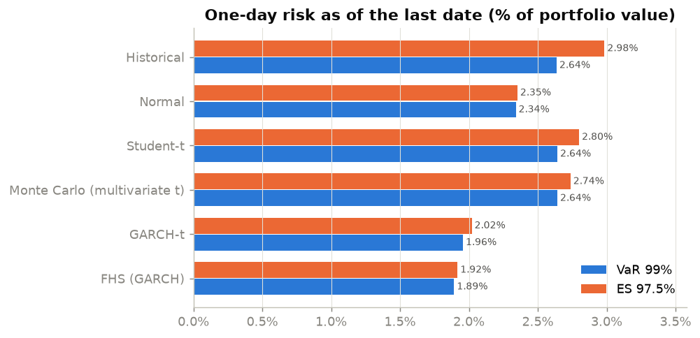
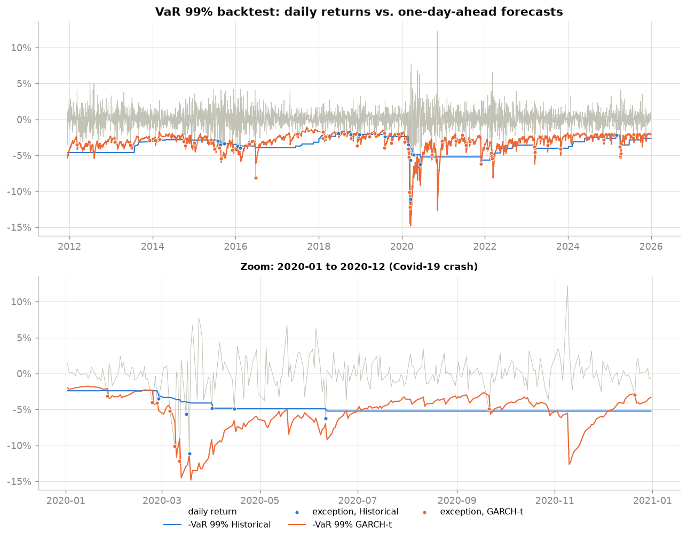
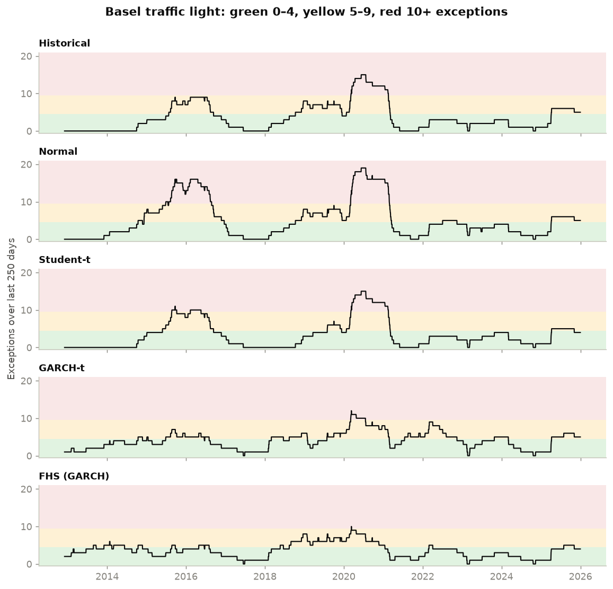
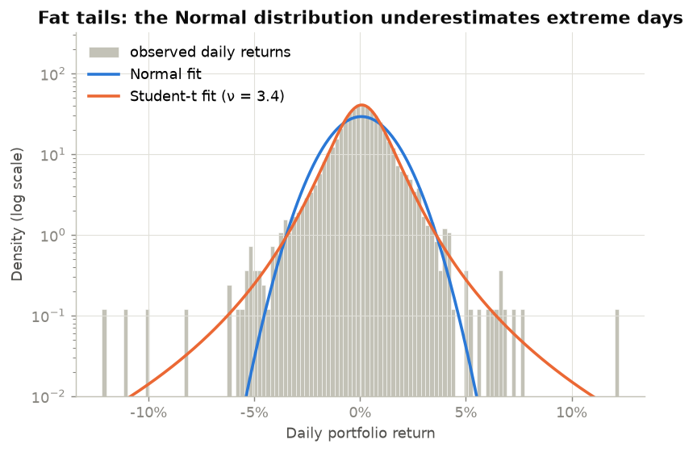
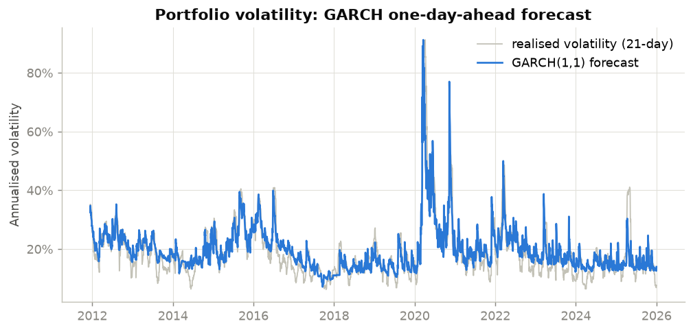

# 02 · Market Risk: VaR, Expected Shortfall, GARCH and Backtesting

## Objective

Measure the one-day market risk of an equity portfolio with the main **Value-at-Risk (VaR)**
and **Expected Shortfall (ES)** methods, then check which ones would have held up in
practice. Each method is backtested over 14 years with the regulatory tests: **Kupiec**,
**Christoffersen** and the **Basel Committee traffic light**.

## Data

- **Portfolio:** five French large caps, equally weighted and rebalanced daily:
  TotalEnergies, BNP Paribas, LVMH, Airbus, Sanofi.
- **Source:** daily adjusted close prices (dividends and splits) from Yahoo Finance via
  `yfinance`, from 5 January 2010 to 31 December 2025, i.e. 4,093 daily returns.
- Details and terms of use are in [DATA.md](DATA.md).

| Portfolio statistics (2010–2025) | Value |
|---|---|
| Annualised return / volatility | 14.7% / 21.6% |
| Skewness / excess kurtosis | -0.28 / 7.64 |
| Jarque–Bera normality test | rejected (p < 0.001) |
| Worst day | -12.2% (12 March 2020) |

## Method

Sign convention: the loss is L = −r. VaR<sub>α</sub> is the α-quantile of L, and ES<sub>α</sub>
is the average loss beyond that quantile. Levels are **VaR 99%** (Basel backtesting level)
and **ES 97.5%** (FRTB level).

| Method | Idea |
|---|---|
| Historical simulation | Empirical quantile of the last 500 daily losses |
| Parametric Normal | μ and σ of the window, Gaussian quantile |
| Parametric Student-t | Student-t fitted by maximum likelihood, which captures fat tails |
| Monte Carlo (multivariate t) | 100,000 joint scenarios for the 5 stocks (sample mean and covariance through a Cholesky factor, Student-t mixing), aggregated with the weights |
| GARCH(1,1)-t | Volatility that reacts to recent shocks (`arch`), Student-t innovations |
| Filtered historical simulation (FHS) | GARCH volatility × empirical quantile of the standardised residuals |

**Backtest.**
- Every day from December 2011 to December 2025 (3,593 days), each method forecasts the next
  day's VaR 99% using only the 500 previous days.
- GARCH parameters are re-estimated every 20 days. In between, the volatility is re-filtered
  with the last parameters.
- An **exception** is a day where the loss exceeds the VaR.
- **Kupiec (POF):** is the exception rate equal to 1%?
- **Christoffersen:** are exceptions independent, or do they come in clusters? The
  conditional coverage test combines both.
- **Basel traffic light:** number of exceptions over a rolling 250-day window.
  Green = 0–4, yellow = 5–9, red = 10 or more.

The Monte Carlo method is used only for the snapshot below. It is not backtested because its
result is very close to the parametric Student-t.

## Results

All numbers come from `python main.py` (see `results/metrics.json`).

### Snapshot: one-day risk for the first trading day of 2026

Computed with the last 500 days (17 Jan 2024 to 31 Dec 2025). € figures are for a
€1,000,000 portfolio.

| Method | VaR 99% | ES 97.5% | VaR 99% (€) | ES 97.5% (€) |
|---|---|---|---|---|
| Historical | 2.64% | 2.98% | 26,364 | 29,839 |
| Normal | 2.34% | 2.35% | 23,401 | 23,518 |
| Student-t | 2.64% | 2.80% | 26,421 | 27,997 |
| Monte Carlo (multivariate t) | 2.64% | 2.74% | 26,418 | 27,372 |
| GARCH(1,1)-t | 1.96% | 2.02% | 19,564 | 20,203 |
| FHS (GARCH) | 1.89% | 1.92% | 18,921 | 19,170 |

- **Normal vs fat-tailed methods.** Under the Normal distribution, ES 97.5% and VaR 99% are
  almost equal (2.35% vs 2.34%). The Basel FRTB framework uses this equivalence to calibrate
  ES 97.5% as a replacement for VaR 99%. With fat tails, ES rises above VaR: 2.98% vs 2.64%
  for historical simulation.
- **GARCH vs historical.** The GARCH-based measures are lower because the market was calm at
  the end of 2025. The forecast volatility was 13.9% annualised, against a median of 17.8%
  over the backtest. The 500-day historical window still contains the April 2025 sell-off
  (−5.2% on 4 April 2025).



### Backtest: VaR 99%, 3,593 days, 35.9 exceptions expected

| Method | Exceptions | Rate | Kupiec p | Independence p | Cond. coverage p | Last 250 days | Windows green / yellow / red |
|---|---|---|---|---|---|---|---|
| Historical | 49 | 1.36% | 0.038 | < 0.001 | < 0.001 | 5 (yellow) | 68% / 25% / 7% |
| Normal | 70 | 1.95% | < 0.001 | < 0.001 | < 0.001 | 5 (yellow) | 56% / 27% / 16% |
| Student-t | 46 | 1.28% | **0.106** | < 0.001 | < 0.001 | 4 (green) | 74% / 15% / 10% |
| GARCH(1,1)-t | 57 | 1.59% | 0.001 | **0.075** | 0.001 | 5 (yellow) | 54% / 43% / 3% |
| FHS (GARCH) | 50 | 1.39% | 0.026 | **0.194** | 0.036 | 4 (green) | 70% / 30% / 0.03% |

**Reading the table** (tests at the 5% level, bold = not rejected):

- **Normal VaR fails clearly.** It has 70 exceptions against 36 expected, a direct
  consequence of the fat tails (excess kurtosis of 7.6).
- **Static methods cluster their exceptions.** Historical, Normal and Student-t react too
  slowly to a volatility shock, so their exceptions come in bursts: independence is rejected
  for all three. The Student-t has the right *number* of exceptions (Kupiec not rejected), but
  at the wrong *moments*.
- **GARCH-based methods fix the clustering** (independence not rejected), but they
  underestimate the *level* of risk: they have too many exceptions.
- **FHS is the best compromise.** It was in the red zone for 0.03% of the rolling windows,
  against 7–16% for the static methods. It is still marginally rejected by Kupiec
  (p = 0.026).
- **No method passes all tests at 5%.**





| | |
|---|---|
|  |  |

## Limitations

- **No method passes every test.** The GARCH models underestimate the level of risk (57 and
  50 exceptions against 36 expected). Possible reasons:
  - the parameters are only refitted monthly;
  - the 500-day window is short for estimating a GARCH;
  - the GARCH is symmetric. It reacts as strongly to a +12% day (9 November 2020, vaccine
    announcement) as to a crash, and it misses the leverage effect. GJR-GARCH or EGARCH would
    be the next step.
- **Simple portfolio.** Five stocks, equal weights, daily rebalancing, no currency risk, no
  derivatives, no position changes. A trading book would require full revaluation of
  non-linear products.
- **One-day horizon only.** The 10-day regulatory horizon is not modelled, not even with the
  √10 rule.
- **ES is not backtested.** Only VaR is backtested; an ES test such as Acerbi–Székely is not
  implemented. The ES figures are point estimates.
- **The Basel zones are used as a diagnostic.** No capital multiplier is computed.
- **Yahoo data are not an official source.** Re-downloading can change the adjusted prices
  slightly. Two independent downloads gave identical exception counts and test results; the
  risk figures differed only at the 8th decimal.

## How to reproduce

```bash
cd 02-market-risk-var-es
python -m venv .venv
.venv\Scripts\activate          # Linux/macOS: source .venv/bin/activate
pip install -r requirements.txt
python main.py
```

Tested with Python 3.14 on Windows. The run takes about 5 minutes, most of it spent on the
3,593 daily re-estimations of the backtest. Prices are cached in `data/prices.csv` after the
first download. Outputs:

- `results/metrics.json`
- `results/snapshot_var_es.csv`
- `results/backtest_summary.csv`
- `results/rolling_var.csv`: daily VaR forecasts
- `figures/*.png`

## Structure

```
02-market-risk-var-es/
├── main.py              # snapshot + rolling backtest + figures
├── src/
│   ├── data.py          # Yahoo download, portfolio returns
│   ├── risk_models.py   # historical, Normal, Student-t, Monte Carlo, GARCH-t, FHS
│   ├── backtest.py      # rolling forecasts, Kupiec, Christoffersen, Basel zones
│   └── plots.py
├── results/  figures/
└── DATA.md  requirements.txt
```
