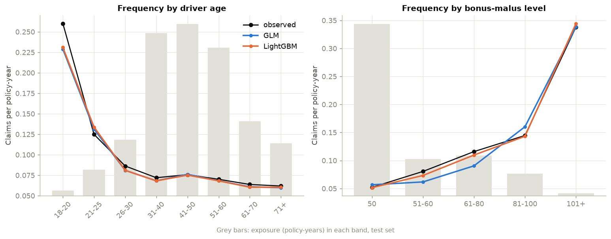
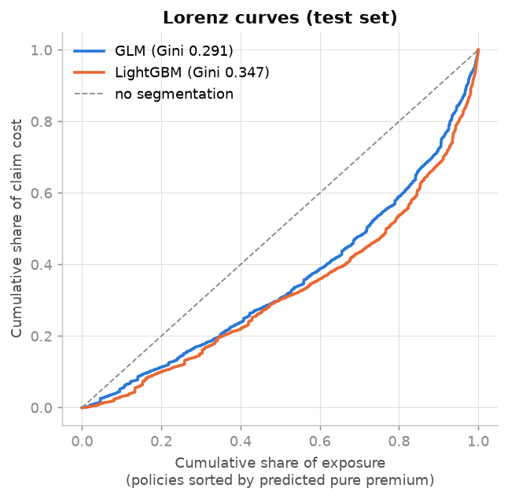
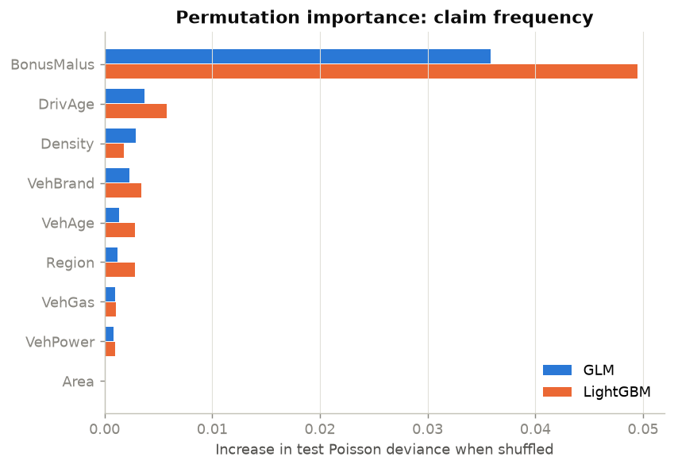
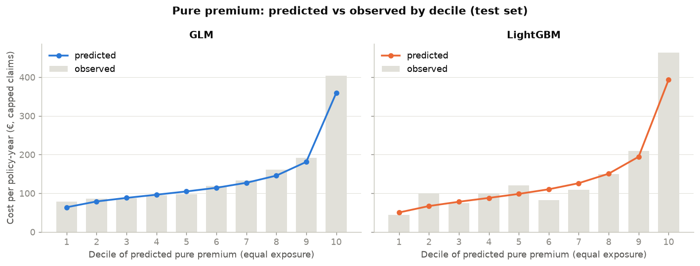
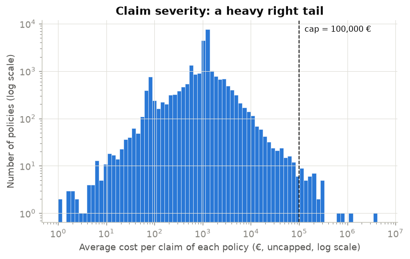

# 03 · Motor Insurance Pricing: Frequency–Severity GLMs vs Gradient Boosting

## Objective

Build a **pure premium** (expected annual claim cost per policy) for French motor
third-party liability insurance with the standard actuarial approach:

**pure premium = claim frequency × average claim cost (severity)**

- **Baseline:** a Poisson GLM for frequency and a Gamma GLM for severity.
- **Challenger:** LightGBM, with the same frequency × severity structure.

The models are compared on deviance, risk segmentation (Lorenz curve and Gini), balance, and
variable importance.

## Data

`freMTPL2freq` and `freMTPL2sev` from OpenML: 678,013 motor liability policies of a French
insurer, observed over one year, with 26,444 recorded claim payments. The rating factors are
driver age, vehicle age, power, brand and fuel, bonus-malus level, population density, area
and region. Source and licence (CC0 on OpenML) are in [DATA.md](DATA.md).

**Data preparation**

| Issue found | Treatment |
|---|---|
| 9,116 policies declare a claim but have **no payment record** | Claim count = number of recorded payments, so frequency and cost stay consistent |
| 1,224 exposures above 1 year | Capped at 1 |
| Claim counts above 4 in a year | Capped at 4 (recording errors) |
| Only 41 claims exceed €100,000, yet the part above €100,000 is 17.7% of the total cost | Claims **capped at €100,000**. The excess is priced through a proportional **large-claim loading** of +23.5%, estimated on train |

## Method

1. **Split.** 80/20 train/test split, seed 42: 542,410 / 135,603 policies. The observed
   frequency is 7.33% on train and 7.54% on test.
2. **GLM features.** Actuarial banding where the effect is non-linear (driver age, vehicle
   age, vehicle power capped at 9) and logarithms for skewed variables (density).
3. **Frequency GLM.**
   - Poisson distribution, log link, offset `log(exposure)`, so that
     `E[N] = exposure × exp(x'β)`.
   - The coefficients read directly as multiplicative **relativities** `exp(β)`.
4. **Severity GLM.**
   - Gamma distribution, log link, on the average capped cost per claim, weighted by the
     number of claims.
5. **Factor selection** (training data only).
   - Backward elimination on the joint Wald p-value of each rating factor, with a 5%
     threshold.
   - Frequency: 8 of 9 factors are kept. `Area` is dropped because density already carries
     that information.
   - Severity: only 3 factors are kept (driver age, vehicle power, area).
6. **LightGBM challenger.**
   - Frequency: Poisson objective on `claims / exposure`, weighted by exposure.
   - Severity: Gamma objective, weighted by the number of claims.
   - The number of trees is chosen by early stopping on a validation split of the training
     set, then the model is refitted on all of it.
7. **Balance correction.** Each model's premiums are rescaled so that total predicted cost
   equals total observed cost on train. The factors are 1.000 for the GLM (the Poisson GLM
   with log link is balanced by construction) and 1.046 for LightGBM.
8. **Evaluation on the test set.**
   - Poisson deviance (frequency) and Gamma deviance (severity), each compared with a
     constant model.
   - Lorenz curve and Gini of the pure premium.
   - Predicted vs observed cost by decile of premium.
   - Permutation importance: increase in deviance when one factor is shuffled.

## Results

All numbers come from `python main.py` (see `results/metrics.json`).

| Test set | GLM | LightGBM |
|---|---|---|
| Frequency: Poisson deviance (constant model: 0.4858) | 0.4654 | **0.4542** |
| Frequency: share of deviance explained | 4.2% | **6.5%** |
| Severity: share of deviance explained vs a constant | -1.4% | -0.2% |
| Pure premium: Lorenz Gini | 0.291 | **0.347** |
| Highest / lowest decile of predicted premium | 5.6× | 7.8× |
| Predicted / observed cost, capped claims | 0.935 | 0.934 |
| Predicted (loaded) / observed cost, all claims | 1.012 | 1.010 |
| Mean pure premium incl. large-claim loading | €167.8 | €167.5 |

- **Frequency: LightGBM wins.** It explains 6.5% of the Poisson deviance, against 4.2% for the
  GLM. Such low shares are normal in motor insurance, because claims are rare and largely
  random. LightGBM's main gain comes from the **bonus-malus** effect. The GLM treats it as
  linear (+2.8% claim frequency per point) and therefore mis-prices the 51–80 range
  (figure below).
- **Severity: neither model beats a constant average cost.** With these rating factors, the
  average cost per claim is essentially unpredictable on unseen data. The GLM's few
  significant effects on train, such as 18–20 year-old drivers at ×1.90, do not generalise.
  LightGBM stops after 25 trees, which means it found almost nothing to learn.
- **Pure premium: LightGBM segments risks better.** Its Gini is 0.347 against 0.291, and its
  average premium ranges from €50 to €393 per year across deciles (capped claims, before
  the large-claim loading). The GLM's deciles, however, follow
  the observed cost more smoothly (see the decile figure).
- **Balance.** After the train-based correction, both models under-predict the capped cost of
  the test set by about 6.5%. This is because the test set happens to be riskier: frequency
  7.54% vs 7.33%, and average capped cost €1,927 vs €1,852.

**Selected frequency GLM relativities** (reference = 41–50 year-old driver, 5–9 year-old
vehicle), from `results/glm_frequency_relativities.csv`:

| Factor | Relativity | Reading |
|---|---|---|
| Bonus-malus (+1 point) | ×1.028 | +2.8% expected frequency per point of malus |
| Vehicle power 9+ (vs 4) | ×1.26 | More powerful cars have more claims |
| Vehicle age 15+ years | ×0.69 | Old cars have fewer claims (they are probably driven less) |
| Driver 26–30 years | ×0.61 | Once bonus-malus is accounted for, young adults are not riskier |
| Regular fuel (vs diesel) | ×0.85 | Diesel cars are often high-mileage vehicles |
| log(density) (+1) | ×1.08 | Denser areas have more claims |



| | |
|---|---|
|  |  |





## Limitations

- **Severity is not modelled better than a constant.** The pure premium's segmentation comes
  almost entirely from frequency. In practice, severity would be split by guarantee (bodily
  injury vs material damage), which this dataset does not allow.
- **Linear bonus-malus in the GLM.** This is the main source of the gap with LightGBM. A
  banded or spline bonus-malus, and interactions such as age × bonus-malus, are the obvious
  next steps for the GLM.
- **Missing claim amounts.** 27% of the policies with a declared claim (9,116 of 34,060) have
  no recorded amount. They are treated as claims without payment, which lowers the modelled
  frequency.
- **Large-claim treatment is simple.** The €100,000 cap and the flat loading of +23.5% rest
  on only 41 claims above the cap. An extreme value (Pareto) model would be more robust. The
  "all claims" balance ratio on test is very sensitive to the few large claims that happen
  to fall in the test set.
- **Random split, one year of data.** There is no out-of-time validation and no
  cross-validation. Some policies are probably duplicates of the same insured.
- **Technical premium only.** This is the pure premium: no expenses, commissions, profit
  margin, commercial constraints or regulatory constraints. Under EU rules, gender cannot be
  used in pricing; it is not in the data.
- **LightGBM is harder to use for pricing.** It needs a balance correction (×1.046 here), its
  tariff is harder to explain, and it is not naturally monotone in bonus-malus.

## How to reproduce

```bash
cd 03-insurance-pricing-glm
python -m venv .venv
.venv\Scripts\activate          # Linux/macOS: source .venv/bin/activate
pip install -r requirements.txt
python main.py
```

Tested with Python 3.14 on Windows. The run takes about 5 minutes, mostly for the
permutation importance and the GLM selection loops. The data (about 7 MB) are downloaded from
OpenML on the first run. Outputs:

- `results/metrics.json`
- `results/glm_*_summary.txt`: regression tables
- `results/glm_*_relativities.csv`
- `results/premium_deciles.csv`
- `results/permutation_importance.csv`
- `results/one_way_frequency.csv`
- `figures/*.png`

## Structure

```
03-insurance-pricing-glm/
├── main.py              # full pipeline
├── src/
│   ├── data.py          # OpenML download, reconciliation, capping, GLM banding
│   ├── models.py        # Poisson/Gamma GLMs with backward selection, LightGBM
│   ├── evaluation.py    # deviance, Lorenz/Gini, deciles, permutation importance
│   └── plots.py
├── results/  figures/
└── DATA.md  requirements.txt
```

**Reference:** A. Noll, R. Salzmann, M. V. Wüthrich (2018), *Case Study: French Motor
Third-Party Liability Claims*, SSRN 3164764. This paper inspired the banding choices.
