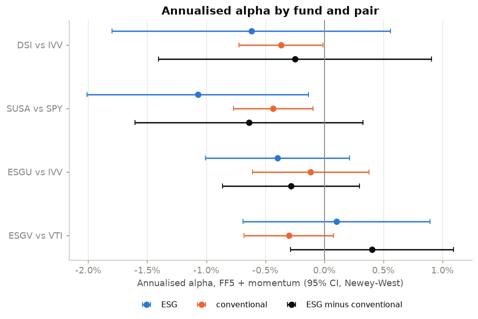
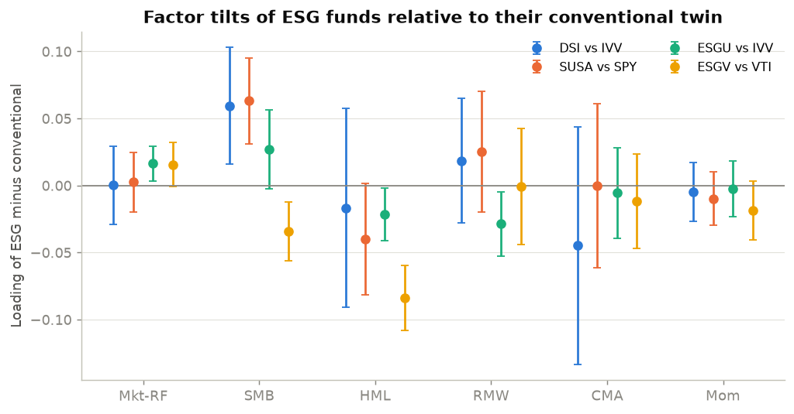
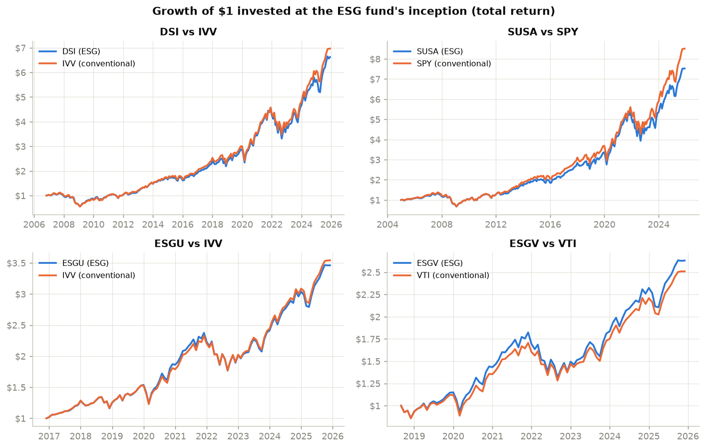

# 04 · ESG vs Conventional Funds: Fama-French Factor Analysis

## Objective

Do ESG equity funds deliver a different **risk-adjusted performance** than comparable
conventional funds, or do they just carry different **style exposures**?

Four US ESG ETFs are each paired with a conventional ETF covering the same market. Each
fund, and the "ESG minus conventional" difference, is regressed on the CAPM, the
Fama-French 3-factor model and the Fama-French 5-factor model plus momentum. Standard
errors are Newey-West. The regressions give the alpha, the factor loadings (betas) and their
significance.

## Data

| ESG ETF | Conventional twin | Months (to Dec 2025) |
|---|---|---|
| DSI: iShares MSCI KLD 400 Social | IVV: iShares Core S&P 500 | 229 (from Dec 2006) |
| SUSA: iShares MSCI USA ESG Select | SPY: SPDR S&P 500 | 251 (from Feb 2005) |
| ESGU: iShares ESG Aware MSCI USA | IVV: iShares Core S&P 500 | 108 (from Jan 2017) |
| ESGV: Vanguard ESG U.S. Stock | VTI: Vanguard Total Stock Market | 87 (from Oct 2018) |

- **ETF returns:** monthly total returns (adjusted close, Yahoo Finance via `yfinance`).
- **Factors:** monthly factors Mkt-RF, SMB, HML, RMW, CMA, momentum and the risk-free rate
  from the **Kenneth French Data Library**.
- Sources and terms of use are in [DATA.md](DATA.md).

The pairs are not perfect twins. The ESG index is built from a slightly different universe:
DSI and ESGU come from MSCI USA universes, while IVV and SPY track the S&P 500. The
"ESG minus conventional" test therefore measures ESG screening *plus* those universe
differences.

## Method

1. **Excess returns.** Each fund's excess return over the risk-free rate is regressed on:

   | Model | Regression |
   |---|---|
   | CAPM | r − rf = α + β·MKT + ε |
   | FF3 | + s·SMB (size) + h·HML (value) |
   | FF5 + Mom | + r·RMW (profitability) + c·CMA (investment) + m·MOM (momentum) |

2. **Difference portfolio.** Each pair is also studied through the monthly return
   difference *ESG − conventional*. This long–short portfolio needs no capital, so it is
   regressed directly on the factors: its alpha is the ESG fund's alpha *relative to its twin*.
   This is the key test. The conventional twin is regressed on the same months as its ESG
   fund.
3. **Inference.**
   - Newey-West (HAC) standard errors with 6 lags, which are robust to heteroscedasticity and
     autocorrelation.
   - Alphas are annualised as 12 × the monthly alpha.
   - For each regression I also report the **minimum detectable alpha**, i.e. the smallest
     annual alpha that the sample would detect with 80% power in a 5% two-sided test:
     `(1.96 + 0.84) × SE(α) × 12`.

## Results

All numbers come from `python main.py` (see `results/metrics.json` and
`results/factor_regressions.csv`).

### Raw performance (each pair over the ESG fund's life)

| Pair | Annual return ESG / twin | Volatility ESG / twin | Sharpe ESG / twin | Tracking error |
|---|---|---|---|---|
| DSI vs IVV | 10.41% / 10.71% | 15.8% / 15.4% | 0.62 / 0.65 | 2.77% |
| SUSA vs SPY | 10.13% / 10.78% | 15.2% / 14.8% | 0.60 / 0.66 | 2.41% |
| ESGU vs IVV | 14.79% / 15.08% | 15.9% / 15.6% | 0.81 / 0.84 | 1.19% |
| ESGV vs VTI | 14.27% / 13.53% | 17.9% / 17.6% | 0.69 / 0.67 | 1.80% |

### Alpha of ESG minus conventional (FF5 + momentum)

| Pair | Annual alpha | t-stat (NW) | p-value | Min. detectable alpha | Adj. R² |
|---|---|---|---|---|---|
| DSI − IVV | -0.25% | -0.42 | 0.67 | 1.65% | 0.03 |
| SUSA − SPY | -0.64% | -1.30 | 0.20 | 1.38% | 0.04 |
| ESGU − IVV | -0.28% | -0.95 | 0.34 | 0.83% | 0.22 |
| ESGV − VTI | +0.40% | +1.14 | 0.25 | 0.99% | 0.59 |

- **No ESG fund has a statistically significant alpha relative to its conventional twin.**
  The point estimates are small: between −0.64% and +0.40% a year. The 95% confidence
  intervals all include zero.
- **Absence of evidence is not evidence of absence.** With 7 to 21 years of data, only
  alphas larger than 0.8% to 1.7% a year could have been reliably detected.
- **Both kinds of funds show slightly negative alphas on their own.** Against FF5 + momentum,
  SUSA has −1.07% (t = −2.24) and even SPY has −0.43% (t = −2.50). The Fama-French factors
  are hypothetical long–short portfolios without trading costs or fees, so real funds often
  show small negative alphas against them. This is why the difference portfolio is the fairer
  test.

### Where ESG funds differ: factor tilts

Loadings of the ESG − conventional portfolio (FF5 + momentum, Newey-West t-stats):

| Pair | Main significant tilts |
|---|---|
| DSI − IVV | more small/mid caps (SMB +0.060, t = 2.67) |
| SUSA − SPY | more small/mid caps (SMB +0.063, t = 3.88); slightly less value (HML −0.040, t = −1.89) |
| ESGU − IVV | less value (HML −0.022, t = −2.16), less profitability (RMW −0.029, t = −2.34) |
| ESGV − VTI | clearly **less value** (HML −0.084, t = −6.72), larger caps (SMB −0.034, t = −3.09) |

- ESGV excludes sectors such as fossil fuels, which weigh heavily in value indexes. This
  gives it a pronounced growth tilt, and the factors explain 59% of its return difference
  with VTI.
- ESGV's +0.74 pp annual outperformance over 2018–2025 is therefore largely a **style**
  effect: growth outperformed value over that period. It is not an ESG "alpha".







## Limitations

- **Low statistical power.** Tracking errors are small (1.2–2.8% a year) and samples are
  short, particularly for ESGU (9 years) and ESGV (7 years). Only large alpha differences
  could be detected.
- **Imperfect pairs.** The ESG and conventional indexes differ by universe and weighting, not
  only by ESG screening.
- **Four ETFs, one country, one period.** These are not a representative sample of ESG funds,
  and 2005–2025 includes strong sector trends (energy, technology) that drive the style
  effects. The results say nothing about European funds or active ESG funds.
- **Fees and trading costs are not separated.** They are part of both alphas, and ETF
  expense ratios differ slightly within pairs.
- **Linear, constant betas.** Exposures probably changed over time; rolling regressions would
  show that.
- **Data revisions.** Yahoo adjusted prices and the Kenneth French factors are revised from
  time to time. Two independent downloads gave identical alphas to 5 decimals; only very
  large t-statistics differed, at the 3rd decimal.

## How to reproduce

```bash
cd 04-esg-fama-french
python -m venv .venv
.venv\Scripts\activate          # Linux/macOS: source .venv/bin/activate
pip install -r requirements.txt
python main.py
```

Tested with Python 3.14 on Windows. The run takes about 15 seconds; data are cached in
`data/` after the first run. Outputs:

- `results/metrics.json`
- `results/factor_regressions.csv`: all funds × all models, with alphas, betas, t-stats and
  R²
- `figures/*.png`

## Structure

```
04-esg-fama-french/
├── main.py              # regressions for each pair + figures
├── src/
│   ├── data.py          # Kenneth French factors (zip/CSV parser), ETF monthly returns
│   ├── regression.py    # CAPM / FF3 / FF5+Mom with Newey-West errors, performance stats
│   └── plots.py
├── results/  figures/
└── DATA.md  requirements.txt
```

**References:**
- E. Fama and K. French (2015), *A five-factor asset pricing model*, Journal of Financial
  Economics 116(1).
- M. Carhart (1997), *On persistence in mutual fund performance*, Journal of Finance 52(1).
