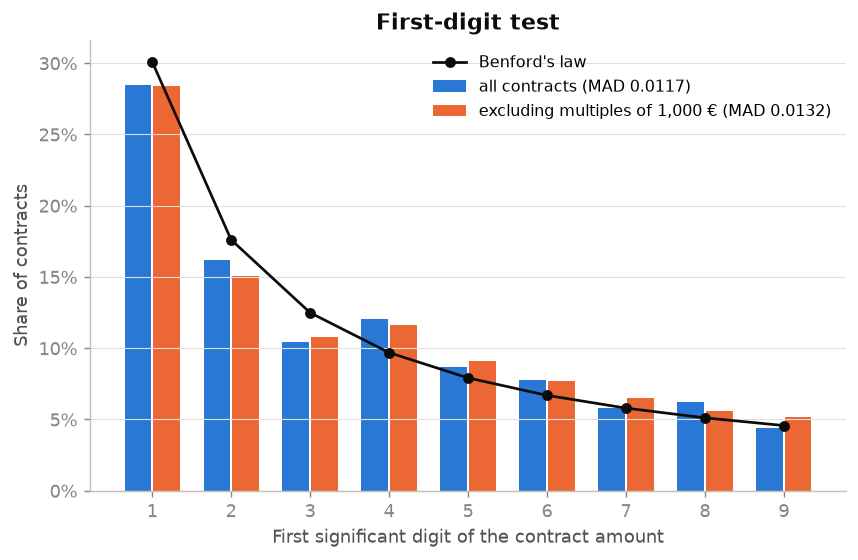
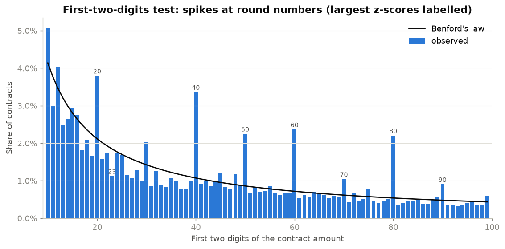
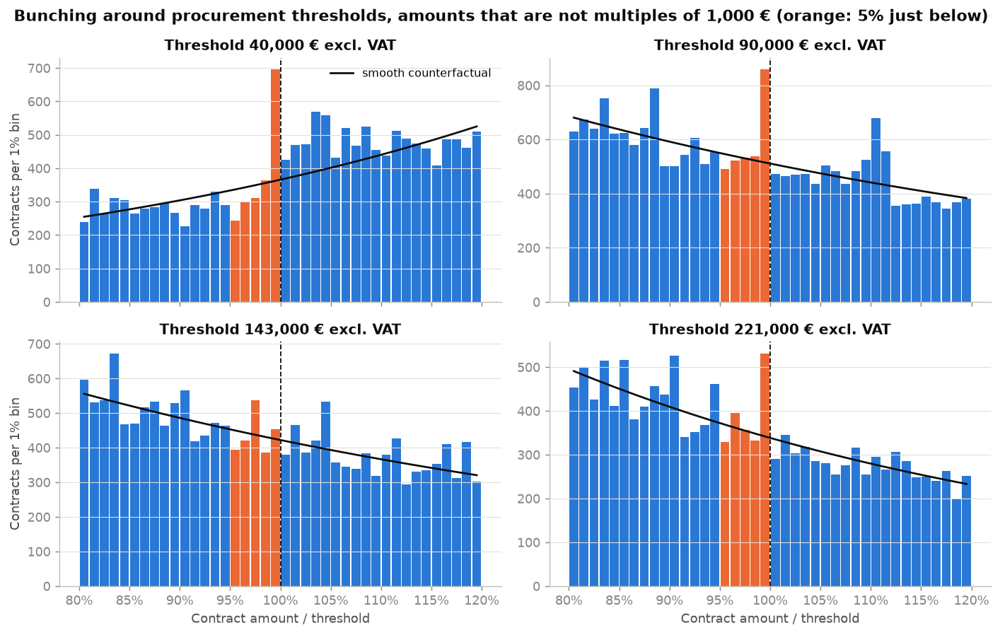
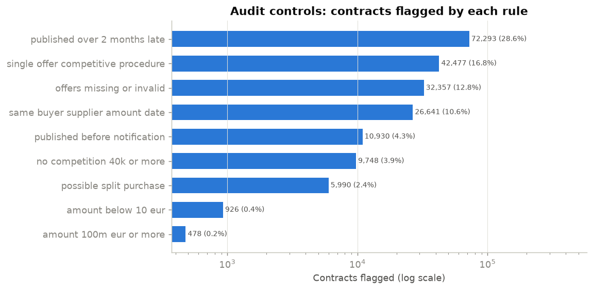

# 05 · Audit Analytics: Benford's Law and Anomaly Detection on French Public Procurement

## Objective

Apply the data-analytics tests that auditors use on a large public dataset: **252,344
French public procurement contracts** notified in 2025. The analysis covers:

1. **Benford's law**: first-digit and first-two-digits tests, with Nigrini's MAD criteria.
2. **Round numbers and duplicated amounts** (number-duplication test).
3. **Bunching just below regulatory thresholds** (40,000 €, 90,000 €, 143,000 €, 221,000 €),
   where amounts may be set to avoid a stricter procedure.
4. **Rule-based controls**: data quality, timeliness, competition and possible split
   purchases.
5. **Isolation Forest**: an unsupervised ranking of unusual contracts to prioritise review.

> **Important.** A statistical deviation or a flag is a *reason to look at a record*, never
> evidence of fraud. Most flags in open procurement data come from reporting conventions
> and data-entry errors. No buyer or supplier is named in this README.

## Data

*Données essentielles de la commande publique* (DECP), 2022 schema, published by the French
Ministry of Economy on data.economie.gouv.fr under the **Licence Ouverte / Etalab 2.0**.

- **Extract:** contracts notified in 2025 and published by 1 September 2026, i.e. 253,863
  rows.
- **Deduplication:** a framework agreement awarded to several suppliers repeats its amount
  once per supplier, so one record is kept per buyer, contract id, amount and date. That
  leaves 252,344 contracts, 14,755 buyers and €400 bn of declared amounts.
- Download details are in [DATA.md](DATA.md).

Amounts are the **initial declared amount excluding VAT**. For framework agreements this is
often an estimate or a *maximum*, not money actually spent.

## Method

| Test | Implementation | Reading |
|---|---|---|
| Benford, first digit | P(d) = log₁₀(1 + 1/d), amounts ≥ 10 €. χ² test and **MAD** (mean absolute deviation) | Nigrini thresholds for MAD: 0.006 / 0.012 / 0.015 (close / acceptable / marginal / nonconformity) |
| Benford, first two digits | Digits 10–99, z-statistic per digit | MAD thresholds 0.0012 / 0.0018 / 0.0022 |
| Round numbers | Share of multiples of 1,000 € and 10,000 €; most frequent exact amounts | Estimated or capped amounts, not computed prices |
| Threshold bunching | Amounts divided by the threshold, bins of 1% between 80% and 120%. A log-linear density fitted away from the threshold (outside 95–105%) gives the counterfactual. One-sided Poisson test on the 5% just below; binomial test comparing the 1% just below with the 1% just above | Excess mass just below a threshold = amounts possibly adjusted to stay under it |
| Rule-based controls | 9 rules (see results) | Each rule is a standard audit test |
| Isolation Forest | 300 trees. Features: log amount, amount vs median of its CPV division, duration, number of offers (and whether it is missing), procedure, price type. Top 1% ranked | Unsupervised: "different from the rest", not "wrong" |

Because round amounts create spikes of their own (for example, a 220,000 € maximum sits just
below the 221,000 € EU threshold), bunching is measured on amounts that are **not multiples
of 1,000 €**. The version including round amounts is also reported.

## Results

All numbers come from `python main.py` (see `results/metrics.json`).

### 1. Benford's law

| Sample | n | MAD | Nigrini conclusion | χ² p-value |
|---|---|---|---|---|
| All contracts, first digit | 251,418 | 0.0117 | acceptable conformity | < 0.001 |
| Excluding multiples of 1,000 €, first digit | 161,507 | 0.0132 | marginally acceptable | < 0.001 |
| All contracts, first two digits | 251,418 | 0.0029 | **nonconformity** | < 0.001 |

- **The χ² test rejects everything.** With 250,000 observations it detects even tiny
  deviations. This is why Nigrini recommends the MAD for large datasets.
- **Round numbers drive the two-digit nonconformity.** The largest deviations are at 80,
  40, 60, 50 and 20 (z = 114, 111, 98, 75, 58). **36% of amounts are multiples of 1,000 €**
  and 26% are multiples of 10,000 €. The most frequent amounts are 200,000 € (3,674
  contracts), 40,000 € (2,944) and 100,000 € (2,825). These are typical framework-agreement
  maxima.
- **By procedure.** Open tenders conform acceptably (MAD 0.0098). Contracts awarded
  **without advertising or competition** do not (MAD 0.0175): they have too few amounts
  starting with 1 (24% vs 30% expected) and too many starting with 4 (12.5% vs 9.7%).




### 2. Bunching below thresholds (amounts not multiples of 1,000 €)

| Threshold (excl. VAT) | Rule | 5% below: observed / expected | p-value | 1% below vs 1% above | p-value |
|---|---|---|---|---|---|
| 40,000 € | no advertising/competition below; DECP publication above | 1,911 / 1,747 (×1.09) | < 0.001 | 696 vs 426 | < 0.001 |
| 90,000 € | formal notice required above (adapted procedure) | 2,940 / 2,651 (×1.11) | < 0.001 | 859 vs 472 | < 0.001 |
| 143,000 € | EU threshold, central government supplies & services | 2,190 / 2,186 (×1.00) | 0.47 | 454 vs 380 | 0.006 |
| 221,000 € | EU threshold, local authorities supplies & services | 1,945 / 1,775 (×1.10) | < 0.001 | 531 vs 290 | < 0.001 |

- **Clear bunching just below 90,000 € and 221,000 €.** Just below 90,000 €, there are
  **1.8 times** more contracts in the last 1% before the threshold than in the first 1%
  after it.
- **Round amounts reinforce the effect at 221,000 €.** When they are included, the 5% below
  holds 1.53 times the expected count, because 963 contracts are worth exactly 220,000 €.
- **No excess mass at 143,000 €.** It applies only to central government buyers, a small
  share of contracts.
- **The 40,000 € result is confounded.** Publication in DECP is only mandatory from 40,000 €,
  so the data under-represent smaller contracts and the density jumps at the threshold.
- **Legitimate explanations exist for every threshold**, such as budgets set "up to" a
  threshold, or estimates rounded down. Bunching identifies *populations* to sample, not
  individual wrongdoing.



### 3. Rule-based controls

| Control | Contracts flagged | Share |
|---|---|---|
| Published more than 2 months after notification | 72,293 | 28.6% |
| Only one offer in a competitive procedure | 42,477 | 16.8% |
| Number of offers missing or invalid (e.g. "MQ NC") | 32,357 | 12.8% |
| Same buyer, supplier, amount and date (different contract id) | 26,641 | 10.6% |
| Publication date before notification date | 10,930 | 4.3% |
| No advertising or competition while ≥ 40,000 € | 9,748 | 3.9% |
| Possible split purchase: same buyer, supplier, CPV division and month; several contracts < 40,000 € adding up to ≥ 40,000 € | 5,990 | 2.4% |
| Amount below 10 € | 926 | 0.4% |
| Amount of 100 M€ or more | 478 | 0.2% |

- **Single-bid tenders (16.8%)** are a common procurement-integrity risk indicator, though
  often explained by specialised markets.
- **Same buyer/supplier/amount/date matches.** There are 12,460 such groups. In 72% of them
  the contracts share the same CPV code, but in 92% their descriptions differ. This points
  mainly to lots or geographic parts of one tender with identical maxima, rather than
  double recordings; only a manual check would separate the two. These figures come from
  a one-off check, not from `main.py`.
- **Some contracts without competition above 40,000 € are legal**, for example in cases of
  urgency, exclusivity or a failed prior tender.



### 4. Isolation Forest

- The top 1% contains 2,524 contracts, and **89% of them are also caught by at least one
  rule** (60% for all contracts).
- Their median amount is 1.2 M€, against 115 k€ for all contracts.
- **45% of them have an amount below 10 € or of at least 100 M€.** The highest-ranked
  records are contracts declared at **1 €** with 51 offers and a 10-year duration: framework
  agreements recorded without an amount.

The unsupervised model therefore mainly re-discovers **data-quality problems and extreme
amounts**. That is useful for cleaning data before any further analysis, but it is not a
fraud detector. The script writes the ranked list (200 records) to
`results/top_anomalies.csv`. That file is not versioned, because it identifies individual
buyers.

## Limitations

- **Declared amounts are not payments.** Many are estimates or framework maxima, which
  breaks one of Benford's conditions (naturally occurring, unconstrained amounts). The
  nonconformity is largely structural.
- **Incomplete coverage.** Publication is only mandatory from 40,000 €, and some buyers
  publish late or not at all. Data published after 1 September 2026 are excluded.
- **Simple bunching estimator.** The counterfactual is a log-linear fit on a ±20% window,
  and the p-values ignore its estimation error. Different windows would change the exact
  figures.
- **Rules need legal context.** Several flags have legitimate explanations that only the
  procurement file can confirm. The 2-month publication delay is used as a reference
  timeliness benchmark.
- **No ground truth.** Without confirmed fraud cases, no detection rate or precision can be
  computed; the Isolation Forest cannot be validated.
- **Snapshot.** DECP records are corrected over time. A download on a later date may differ
  slightly, even with the same filters. Two downloads a few minutes apart were identical.

## How to reproduce

```bash
cd 05-audit-benford
python -m venv .venv
.venv\Scripts\activate          # Linux/macOS: source .venv/bin/activate
pip install -r requirements.txt
python main.py
```

Tested with Python 3.14 on Windows. The run takes about 1 minute, including a 60 MB download
from the data.economie.gouv.fr API on the first run. Outputs:

- `results/metrics.json`
- `results/benford_*.csv`
- `results/top_anomalies.csv` (local only)
- `figures/*.png`

## Structure

```
05-audit-benford/
├── main.py              # all tests + figures
├── src/
│   ├── data.py          # API extract, cleaning, deduplication
│   ├── benford.py       # first / first-two digit tests, MAD, z-scores
│   ├── thresholds.py    # bunching estimator and tests
│   ├── anomalies.py     # rule-based controls, Isolation Forest
│   └── plots.py
├── results/  figures/
└── DATA.md  requirements.txt
```

**Reference:** M. Nigrini (2012), *Benford's Law: Applications for Forensic Accounting,
Auditing, and Fraud Detection*, Wiley.
