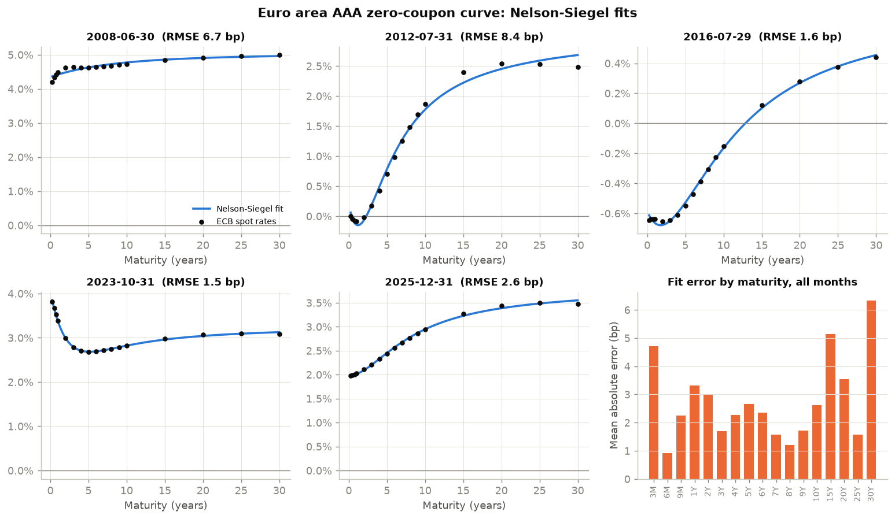
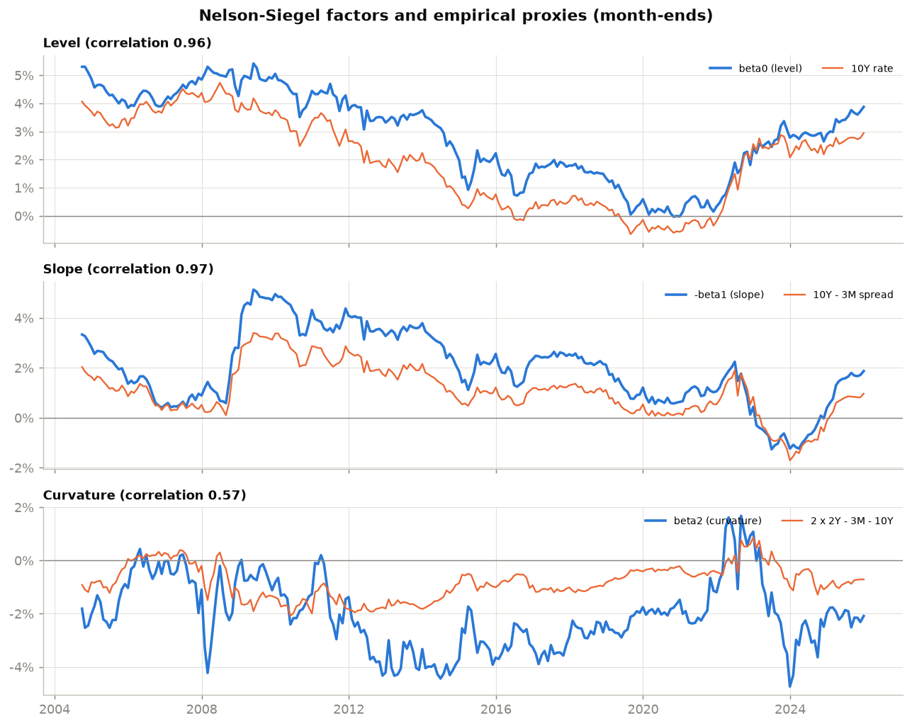
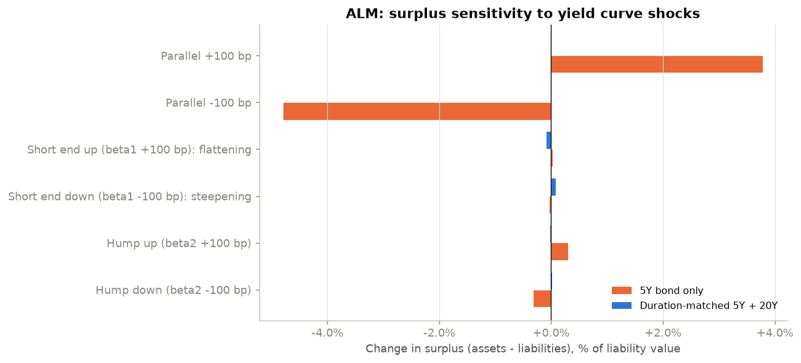

# 06 · Yield Curve Modelling (Nelson-Siegel) and ALM Interest Rate Risk

## Objective

1. **Fit the Nelson-Siegel model** to the euro area AAA government zero-coupon curve
   published by the ECB, every month from 2004 to 2025.
2. **Read its three factors** (level, slope, curvature) through the rate cycles: the 2008
   crisis, negative rates, the 2022 tightening.
3. **Apply it to asset–liability management (ALM).**
   - Value a stylised run-off liability book.
   - Measure durations and convexities.
   - Stress the surplus under parallel and non-parallel curve shocks built from the
     Nelson-Siegel factors.

## Data

ECB Data Portal, dataset `YC`: the euro area yield curve for AAA-rated central government
bonds.

- **Spot rates:** daily, 17 maturities from 3 months to 30 years, from 6 September 2004 to
  31 December 2025 (5,451 days). The model is fitted on the 256 month-ends.
- **ECB Svensson parameters** for the same days (β0–β3, τ1, τ2).
- Source and terms are in [DATA.md](DATA.md).

The ECB spot rates are themselves produced by the ECB's **Svensson model** (continuously
compounded) estimated on bond prices. This project fits a *simpler* model to a curve that
is already smooth; see Limitations.

## Method

**Nelson-Siegel model** for the zero rate at maturity *m*:

```
y(m) = β0 + β1 · (1 − e^(−m/τ)) / (m/τ) + β2 · [ (1 − e^(−m/τ)) / (m/τ) − e^(−m/τ) ]
```

| Factor | Loading | Interpretation |
|---|---|---|
| β0 | 1 at all maturities | long-term **level** (limit as m → ∞) |
| β1 | 1 at m = 0, decays to 0 | **slope**: the short rate is β0 + β1, so −β1 ≈ long − short |
| β2 | 0 at both ends, peaks at medium maturities | **curvature** (hump or trough) |
| τ | – | where the loadings decay, i.e. the location of the hump |

1. **Validating the formula.** The daily curves are rebuilt from the ECB's own Svensson
   parameters (Nelson-Siegel plus a second hump term) and compared with the published spot
   rates.
2. **Estimation.** For a given τ the model is linear in the β's, so they come from OLS
   (profile least squares).
   - τ is chosen by a grid search between 0.2 and 10 years, then refined by a bounded
     one-dimensional optimisation.
   - This avoids the local minima of a full non-linear fit.
3. **Factors over time.** Following Diebold and Li (2006), τ is fixed at its median (2.49
   years) to obtain stable factor series. They are compared with standard empirical
   proxies: the 10Y rate, the 10Y–3M spread, and 2×2Y − 3M − 10Y.
4. **ALM application** on the curve fitted at 31 December 2025.
   - **Liabilities:** a run-off annuity-like book, €100 m of nominal payments over 30 years,
     decreasing linearly.
   - **Two asset strategies**, both with the same present value as the liabilities:
     1. only a 5-year 3% coupon bond;
     2. a mix of 5-year and 20-year 3% bonds that matches the liability **duration**
        (Redington immunisation).
   - **Measures:** effective duration and convexity (±1 bp parallel bumps), and **factor
     durations**, i.e. the % change in value when β0, β1 or β2 moves by 100 bp.
   - **Shocks:** parallel ±100 bp, and non-parallel ±100 bp on β1 (the short end moves: a
     flattening or a steepening) and on β2 (the hump).
   - The surplus change is measured as Δassets − Δliabilities.

## Results

All numbers come from `python main.py` (see `results/metrics.json`).

### 1. Validation and fit quality

- **The Svensson formula is validated.** Rebuilding the ECB curve from its published
  parameters matches the spot rates to machine precision on **5,450 of 5,451 days**. The
  exception is 23 June 2022, where parameters and rates disagree by up to 5.6 bp (a data
  inconsistency in the source).
- **Nelson-Siegel fits well:**

  | | Value |
  |---|---|
  | Mean / median RMSE across months | **3.6 bp / 3.0 bp** |
  | Months with RMSE below 5 bp | 67% |
  | Worst month | October 2008, RMSE 14.0 bp |
  | Largest mean absolute errors by maturity | 30Y (6.3 bp), 15Y (5.1 bp), 3M (4.7 bp) |

- **Why the errors sit at those maturities.** The ECB's second hump term shapes the very
  short and very long end, which a three-factor model cannot reproduce.
- **τ can be poorly identified.** In 5.9% of months the best τ sits at a bound of the
  search range (0.2 or 10 years). This happens when the curve is almost flat and τ barely
  changes the fit.



### 2. Factors through the cycle (fixed τ = 2.49 years)

| Factor | Proxy | Correlation |
|---|---|---|
| Level β0 | 10Y rate | 0.96 |
| Slope −β1 | 10Y − 3M spread | 0.97 |
| Curvature β2 | 2×2Y − 3M − 10Y | 0.57 |

- **Level.** It falls from about 5% (2008) to around 0% (minimum −0.03% in October 2020),
  then climbs back to 3.9% at the end of 2025.
- **Slope.** It is **negative from January 2023 to November 2024**: the curve inverted after
  the ECB rate hikes, with short rates above long rates.
- **Fixing τ stabilises the factors.** The standard deviation of monthly changes in β1
  drops from 0.48 to 0.27 percentage points compared with a free τ. When τ is free, it
  trades off against the β's from one month to the next.



### 3. ALM: durations and stress tests (curve of 31 Dec 2025)

**Nelson-Siegel curve on 31 Dec 2025:** β0 = 3.88%, β1 = −1.88%, β2 = −2.06%, τ = 2.52
years. This is an upward-sloping curve from 2.0% (3M) to 3.5% (30Y).

| Portfolio (PV €73.9 m each) | Duration | Convexity | Factor duration β0 / β1 / β2 (% per 100 bp) |
|---|---|---|---|
| Liabilities (€100 m nominal, 30-year run-off) | 8.97 | 123.3 | 8.39 / 2.10 / 1.69 |
| Assets A: 5Y bond only | 4.72 | 23.0 | 4.61 / 2.07 / 1.38 |
| Assets B: duration-matched 5Y + 20Y | 8.97 | 124.6 | 8.39 / 2.18 / 1.70 |

**Surplus change (assets − liabilities):**

| Scenario | A: 5Y only | B: duration-matched |
|---|---|---|
| Parallel +100 bp | **+€2.80 m** (+3.8%) | +€4 k (+0.01%) |
| Parallel −100 bp | **−€3.54 m** (−4.8%) | +€6 k (+0.01%) |
| Short end +100 bp (flattening) | +€20 k (+0.03%) | −€60 k (−0.08%) |
| Short end −100 bp (steepening) | −€23 k (−0.03%) | +€62 k (+0.08%) |
| Hump +100 bp | +€224 k (+0.30%) | −€14 k (−0.02%) |
| Hump −100 bp | −€235 k (−0.32%) | +€12 k (+0.02%) |

Percentages are of the liabilities' value.

- **The duration gap is the main risk.** With only 5-year bonds (duration 4.7 against 9.0),
  a 100 bp **fall** in rates costs €3.5 m of surplus. This is the classic situation of an
  insurer or pension fund whose assets are shorter than its liabilities.
- **Matching the duration removes more than 99% of the parallel risk.** The matched
  portfolio even gains slightly in both directions, because its convexity is higher (124.6
  vs 123.3). This is Redington's convexity condition.
- **Immunisation only protects against parallel shifts.** The matched portfolio is a
  *barbell* (5Y + 20Y) against spread-out liabilities. Its exposure to the short end is
  larger than the liabilities', so a slope shock moves its surplus by ±0.08%. That is
  *more* than for the unmatched 5Y portfolio (±0.03%). Here the residual risks are small,
  but they are real, and factor durations make them visible.



## Limitations

- **The data come from a model.** The ECB spot rates are outputs of a Svensson fit on bond
  prices, so the Nelson-Siegel errors measure how well a 3-factor curve approximates a
  4-factor one. A true fitting exercise would use individual bond prices or yields (not
  freely available here).
- **AAA curve only.** It is not the swap curve, nor the EIOPA risk-free curve with
  Smith-Wilson extrapolation and the ultimate forward rate used for Solvency II liability
  valuation.
- **Stylised ALM.** Deterministic liability cash flows (no lapses, no mortality, no options
  or profit sharing), two plain bonds, and no reinvestment, credit or liquidity risk.
- **Arbitrary shock sizes.** The ±100 bp factor shocks are not calibrated scenarios such as
  the Solvency II standard formula or the Basel IRRBB shocks. Calibrating them on the
  historical distribution of factor changes would be the next step.
- **Unstable τ.** τ is poorly identified in some months (5.9% at a search bound), and the
  6 September 2004 start is set by the ECB series.

## How to reproduce

```bash
cd 06-alm-nelson-siegel
python -m venv .venv
.venv\Scripts\activate          # Linux/macOS: source .venv/bin/activate
pip install -r requirements.txt
python main.py
```

Tested with Python 3.14 on Windows. The run takes about 20 seconds, including the ECB API
download on the first run. Two downloads gave byte-identical data. Outputs:

- `results/metrics.json`
- `results/nelson_siegel_monthly_fits.csv`
- `results/nelson_siegel_factors_fixed_tau.csv`
- `results/alm_surplus_impacts_eur.csv`
- `figures/*.png`

## Structure

```
06-alm-nelson-siegel/
├── main.py              # validation, monthly fits, factors, ALM + figures
├── src/
│   ├── data.py          # ECB Data Portal API
│   ├── curves.py        # Nelson-Siegel / Svensson formulas, profile least squares
│   ├── alm.py           # cash flows, PV, durations, immunisation, shocks
│   └── plots.py
├── results/  figures/
└── DATA.md  requirements.txt
```

**References:**
- C. Nelson and A. Siegel (1987), *Parsimonious modeling of yield curves*, Journal of
  Business 60(4).
- L. Svensson (1994), NBER Working Paper 4871.
- F. Diebold and C. Li (2006), *Forecasting the term structure of government bond yields*,
  Journal of Econometrics 130(2).
- F. Redington (1952), *Review of the principles of life-office valuations*.
